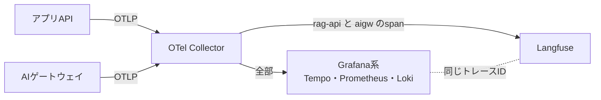

# ADR-004 観測基盤の構成

ステータス: Accepted（2026-11-16）

## 要約

- OpenTelemetry（OTel）を共通の土台にして、トレースIDとメトリクスを全体でそろえる
- システム全体の死活監視はGrafana、AI処理ごとのトレースと評価はLangfuseが受け持つ
- 同じトレースIDで、GrafanaとLangfuseを行き来して調べる

## 背景

AIアプリの観測には2種類の問いがある。

- 「システムは動いているか」：エラー率、レイテンシ、どの段が遅いか。普通のWebシステムと同じ問い
- 「AIの答えは良いか」：どんなプロンプトで、何を検索し、何と答え、評価は何点か。AI特有の問い

前者はGrafanaのような汎用の観測基盤が得意で、後者はLangfuseのようなLLM専用の基盤が得意だ。どちらか1つで両方をこなそうとすると、どこかが弱くなる。

そこで、2つを使い分けたうえで「同じリクエストを両方で引ける」ようにする。その鍵がOTelのトレースIDだ。画面からLLMまでを1本のトレースにしておけば、Grafanaで見つけた遅いリクエストをLangfuseで開き、プロンプトや検索結果まで確かめられる。

OTelの生成AI向けの規約（GenAIセマンティック規約）はまだDevelopment扱いで、属性名が変わりうる。この変化は、間に置くOTel Collectorで吸収する。各部品の詳細は[OTel Collector](../components/otel-collector.md)、[Langfuse](../components/langfuse.md)、[Grafana](../components/grafana.md)の解説を参照。

## 検討した選択肢

### 案A：Langfuse（セルフホスト）とGrafana系を併用する

- 長所：トレース、評価、プロンプト管理、データセットが1つにまとまる。死活監視はGrafanaの得意分野で受け持てる
- 短所：Langfuseだけで Postgres、ClickHouse、Redis、S3互換ストレージが要る。メモリの目安は最低4GB程度
- 学べること：LLM専用の観測と、汎用の観測の役割分担

### 案B：Grafana系（Tempo、Loki）だけに統一する

- 長所：汎用の観測基盤1つで済む
- 短所：評価スコア、プロンプト管理、データセットの機能がない。改善ループ（ADR-008）を自作することになる
- 学べること：OTelの汎用的な使い方

### 案C：Langfuse Cloud と Grafana系を併用する

- 長所：ローカルが軽くなる
- 短所：プロンプトや回答を外部に送る。ガードレールの方針（ADR-005）と相性が悪い
- 学べること：案Aと同じ。ただしセルフホストの運用は学べない

## 比較

| 観点 | 案A：Langfuseセルフホスト＋Grafana | 案B：Grafanaだけ | 案C：Langfuse Cloud＋Grafana |
| --- | --- | --- | --- |
| AI処理の観測（プロンプト、評価） | 強い | 弱い | 強い |
| 死活監視 | 強い | 強い | 強い |
| ローカルのメモリ | 多い | 少ない | 中程度 |
| データの外部送信 | なし | なし | あり |
| 改善ループとの相性 | 良い | 自作が要る | 良い |

## 決定

OpenTelemetryを共通の土台にして、トレースIDとメトリクスを全体で揃える。システム全体の死活監視はGrafana、AI処理ごとのトレースと評価はLangfuseが受け持ち、同じトレースIDで行き来して調査する（選択肢Aを、OTelでつなぐ形にしたもの）。

### 構成

- W3C Trace Context（traceparent）を引き継ぐ。範囲は画面 → API Gateway → Lambda → Envoy AI Gateway → Ollama / Bedrock
- 各コンポーネントはOTLPでOTel Collectorに送る。Collectorが振り分ける
    - 全トレース・メトリクス・ログ → Grafana系（Tempo、Prometheus、Loki）
    - LLM関連のspan → Langfuse
- LangfuseはOTelのトレースIDをそのまま使うので、同じIDでGrafanaとLangfuseの両方を引ける。Grafanaのトレース画面からLangfuseのトレースへリンクを張る
- Envoy AI GatewayのGenAIメトリクス（トークン数、レイテンシなど）もGrafanaで見る

### 調査の流れ

1. Grafanaのアラート（エラー率、レイテンシ、トークン数の急増）で気づく
2. 該当する時間帯のトレースをTempoで開き、どの段（API Gateway、Lambda、ゲートウェイ、LLM）で起きたか特定する
3. 同じトレースIDでLangfuseを開き、プロンプト、検索結果、評価スコアを見る

## 決定の理由

- AI処理の観測と死活監視は、求められる機能が違う。得意な道具に分けたほうが、どちらも深く学べる
- OTelでつなげば、道具を分けても調査が途切れない
- 改善ループ（ADR-008）に必要な評価スコアとデータセットの機能がLangfuseにある

## 影響

- ADR-002：ゲートウェイのOTel出力（GenAIメトリクス、OpenInference形式のspan）を使う
- ADR-005：Langfuseに残すのはマスク後の本文だけにした
- ADR-008：評価スコアをLangfuseのトレースに付ける

## 受け入れること

- LLM関連のトレースをTempoとLangfuseの2か所に保存する。ローカルでは容量とメモリに注意
- GenAIの属性名はまだ固まっていない。Collectorで吸収する

## 確認すること

- [ ] API GatewayとLambdaでtraceparentが引き継がれるか
- [ ] Envoy AI Gatewayのトレース（OpenInference形式）がLangfuseで生成（generation）として表示されるか
- [ ] GrafanaからLangfuseへのリンクの張り方（データリンクでLangfuseのトレースURLを開く）

## 参考資料

- [Langfuse: OpenTelemetry連携（v4移行）](https://langfuse.com/integrations/native/opentelemetry/migration-to-v4.md)
- [Langfuse: OpenTelemetry for LLM Observability](https://langfuse.com/integrations/native/opentelemetry)
- [OpenTelemetry: Semantic conventions for generative AI](https://opentelemetry.io/docs/specs/semconv/gen-ai/)
- [W3C Trace Context](https://www.w3.org/TR/trace-context/)
