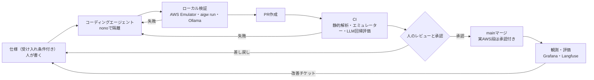

# ADR-012 エージェントによる実装ライン（ソフトウェアファクトリー化）

ステータス: Proposed（流れは合意済み。仕様の置き場所とエージェントの動かし方が未決定）

## 要約

- 仕様を人が書き、コーディングエージェントが実装してPRを出す「実装ライン」を作る
- エージェントはnonoで隔離し、実AWSの認証情報は渡さない
- 品質検査は既存のCIと評価をそのまま使い、人はマージと実AWSへの反映を承認する

## 背景

これまでの設計は「AIアプリを動かして改善する基盤」で、コードは人が書く前提だった。ソフトウェアファクトリーは、決まった入力・組み立て経路・自動の品質管理・再現できる出力を持つ仕組みを指す。今の形では、その中でAIエージェントが実装を担う。人は意図・制約・受け入れ基準・承認ルールを決める。

このリポジトリには、品質検査の部品がすでに揃っている。

- CI/CD（ADR-006）：静的チェック、エミュレーターへのapply
- 品質とサプライチェーン（ADR-013）：リンター、シークレット検出、依存パッケージの検査
- 評価（ADR-008）：RAGの回帰評価
- 観測（ADR-004）：トレースと評価スコア

これらを品質検査として使い回し、その前に実装の工程を足す。課題は、エージェントに何を任せ、何を任せないかの線引きだ。特に、エージェントが誤って実AWSを操作したり、秘密情報を外に送ったりしないようにする必要がある。

## 実装ラインの流れ

## 決まっている方向性

- 人が持つもの：仕様と受け入れ条件、マージの承認、実AWSへのapplyの承認
- エージェントの作業場所はnonoで隔離する。通信先はAWS Emulator、Envoy AI Gateway、Ollama、パッケージのレジストリだけに絞り、実AWSの認証情報は渡さない（ダミートークン）
- 品質検査は既存のCIをそのまま使う。エージェント専用の甘い合格基準は作らない
- 改善ループで見つかった問題（低評価のトレースなど）は、仕様としてラインの入口に戻す

## 選択肢1: 仕様の置き場所と形式

| 案 | 内容 | 長所 | 短所 |
| --- | --- | --- | --- |
| A | GitHub Issues（受け入れ条件をチェックリストで書く） | PRやCIとつながる | 形式は自分で揃える |
| B | リポジトリ内のMarkdown（spec/） | ADRと同じ置き方で、差分を管理できる | 進捗の管理は別に要る |

## 選択肢2: エージェントの動かし方

| 案 | 内容 | 長所 | 短所 |
| --- | --- | --- | --- |
| A | 手元でClaude Codeを対話的に動かす | すぐ始められ、挙動を観察できる | 自動化の度合いは低い |
| B | CIからヘッドレスで起動し、仕様からPRまで自動で進める | ファクトリーに近い | 隔離、権限、コスト上限の設計が要る |

## 受け入れること

- nonoの対応OSやポリシーの細かい書き方は、公開ページでは十分に確認できていない。まずmacOS（Seatbelt）で動くか試す
- エージェントが書いたテストだけを、そのエージェントのコードの合格基準にしない。受け入れ条件のテストは人が書くか、人がレビューする
- AWS EmulatorはIAMを実AWSと同じように評価しない。権限まわりのコードは、エミュレーターで通っても信用しない（ADR-006と同じ）

## 確認すること

- [ ] nonoでClaude Codeを動かし、通信先の絞り込みとダミートークンが効くか
- [ ] AWS Emulatorのエージェント向けスキル（aws agent-toolkit）を使うか
- [ ] エージェントの作業もOTelでトレースし、工程ごとのコストと所要時間を見るか
- [ ] 1件の仕様あたりのトークン上限（ADR-007の予算と合わせる）

## 決定

未定。

## 参考資料

- [TrueFoundry: The Agentic Software Factory, Explained](https://www.truefoundry.com/blog/software-factory-agentic-enterprise-guide)
- [Sonar: What is an agentic software factory](https://www.sonarsource.com/resources/library/what-is-an-agentic-software-factory/)
- [Unblocked: What Is an AI Software Factory? A Buyer's Guide](https://getunblocked.com/blog/what-is-an-ai-software-factory-buyers-guide/)
- [nono](https://nono.sh/)
- [AWS Emulator（AWSブログ）](https://aws.amazon.com/jp/blogs/news/test-your-applications-against-aws-locally-with-aws-emulator/)
