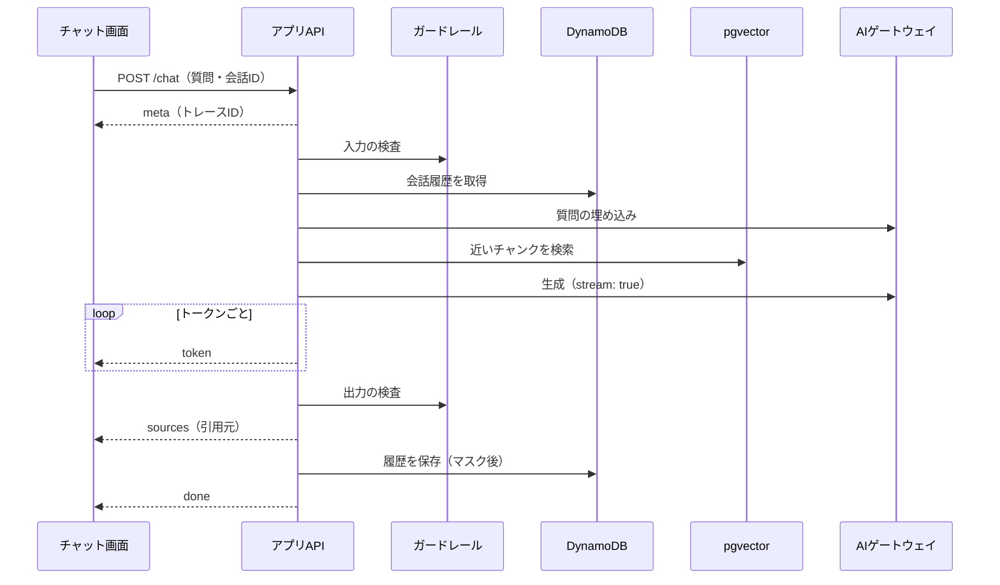

# アプリAPIとチャット画面

## ひとことで

利用者の質問を受け、ガードレール・検索・生成・履歴の保存を順につなぐRAGチャットの本体。回答はストリーミングで少しずつ返す。

## このリポジトリでの役割

| 項目 | 内容 |
| --- | --- |
| アプリAPI | Node.js（TypeScript）。`app/api` |
| チャット画面 | Vite＋React。`app/web` |
| ローカルでの起動 | `make api`（:8787）、`make web`（:5173） |
| 本番想定の形 | 画面は S3＋CloudFront、APIは API Gateway REST（ストリーミング）＋Lambda |
| 関連ADR | [ADR-006](../adr/0006-iac-cicd.md)、[ADR-011](../adr/0011-chat-streaming.md) |

## 仕組み

1つの質問は、次の順に処理される。処理の本体（`runChat`）は1つで、Lambdaのハンドラーとローカルの HTTP サーバーの両方から呼ぶ。

### 応答の形式（NDJSON）

APIは1行に1つのJSONを書いて返す（NDJSON）。画面は1行ずつ読んで表示を更新する。

| type | 意味 |
| --- | --- |
| `meta` | このリクエストのトレースID。画面からLangfuseのトレースを開くのに使う |
| `token` | 生成された文字列の断片 |
| `guard` | ガードレールの判定（ブロック、入力のマスク、出力の差し替え） |
| `sources` | 回答の根拠にした資料の一覧 |
| `error` | 途中で失敗した |
| `done` | 終わり |

### プロンプト

システムプロンプトで「参考資料に書かれていることだけを根拠にする」「根拠を `[1]` のように示す」と指示している。検索結果は番号付きの参考資料としてシステムプロンプトの後ろに付ける。

### ゲートウェイからのストリーミング

ゲートウェイはOpenAI互換のストリーミング形式（Server-Sent Events）で返す。アプリはそれを1イベントずつ読み、差分の文字列だけを `token` として画面に流す。

## 学ぶポイント

- Lambdaのレスポンスストリーミング（`streamifyResponse`）と、API Gatewayのストリーミング応答
- Server-Sent Events と NDJSON の違い。どちらも「1行ずつ読む」形式だが、区切り方が違う
- RAGのプロンプトの組み立て方（参考資料の入れ方、引用の指示）
- 1つの処理を、Lambdaとローカルサーバーの両方から呼べるように分ける設計

## つまずきやすい点

- ストリーミング中に画面を閉じても、Lambdaは最後まで動き続けて課金される（ADR-011）
- AWS EmulatorでAPI Gatewayのストリーミングが再現されるかは未確認。ローカルでは同じ処理をHTTPサーバーで動かしている
- 生成中のトークンはそのまま画面に出るので、出力のPIIは表示の後で差し替わる（ADR-005）

## 参考資料

- [AWS Lambda: Response streaming](https://docs.aws.amazon.com/lambda/latest/dg/configuration-response-streaming.html)
- [MDN: Server-sent events](https://developer.mozilla.org/en-US/docs/Web/API/Server-sent_events)
- [NDJSON](https://github.com/ndjson/ndjson-spec)
