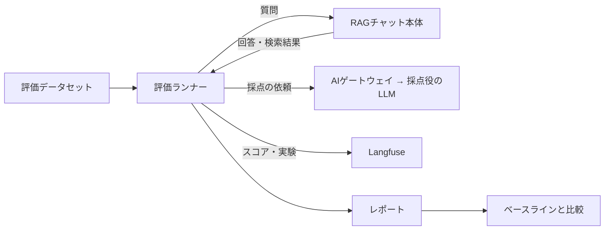

# 評価ランナー

## ひとことで

評価データセットの質問をRAGチャットに流し、検索と回答を採点して、前回の結果（ベースライン）と比べる仕組み。改善ループで「直したら良くなったか」を確かめる。

## このリポジトリでの役割

| 項目 | 内容 |
| --- | --- |
| データセット | `eval/rag-cases.jsonl`（OpenTelemetryのドキュメントから作った15問） |
| 実行 | `task eval`（ローカル。LLMが要る） |
| 比較 | `task eval-compare`（CIでも動く） |
| 結果 | `eval/reports/latest.json`、ベースラインは `eval/baseline.json` |
| 関連ADR | [ADR-008](../adr/0008-evaluation.md) |

## 仕組み



### 測るもの

| 指標 | 測り方 | 何が分かるか |
| --- | --- | --- |
| 検索の的中 | 期待する資料が検索結果に入ったか | 検索（チャンク分割、埋め込み、件数）の良し悪し |
| 引用の有無 | 回答に `[1]` のような引用があるか | プロンプトの指示が守られているか |
| 正しさ（1〜5） | 採点役のLLMが模範解答と比べる | 回答の中身の正しさ |
| 根拠への忠実さ（1〜5） | 採点役のLLMが参考資料と比べる | 資料にないことを言っていないか（ハルシネーション） |
| レイテンシ | 全体と、最初のトークンまで | 体感の速さ |

### LLM-as-a-judge

採点役のLLMに、質問・模範解答・参考資料・回答を渡し、JSONで点数と理由を返させる。採点のプロンプトでは、点数の基準（5点と1点の意味）をはっきり書く。資料に答えがなく「分かりません」と答えた場合は、忠実さを満点にするよう指示している。

採点役の出力は崩れることがあるので、前後の文章やコードブロックを除いてJSONを取り出し、点数を1〜5に丸めている。

### 回帰の判定

| 指標 | 悪化とみなす下がり幅 |
| --- | --- |
| 検索の的中率、引用の付与率 | 10ポイント |
| 正しさ、根拠への忠実さ | 0.3 |
| レイテンシ（中央値） | 1.5倍を超えたら |
| 失敗したケース | 1件でも増えたら |

ローカルのLLMは同じ質問でも答えが揺れるので、少しの差は許している。

## 動かして確かめる

```bash
task eval            # 全15問を流す（数分かかる）
task eval-compare    # ベースラインと比べる
task eval-baseline   # 良くなったら、今回をベースラインにする
```

初めて動かすときはベースラインがないので、比較は飛ばされる。次の順で進める。

1. `task eval` を実行する
2. 最後に表示される `summary` で、`cases` が15、`errors` が0になっていることを確かめる。採点役が失敗しても `task eval` は成功で終わるので、ここで見落とさない
3. 問題がなければ `task eval-baseline` を実行し、`eval/baseline.json` と `eval/reports/latest.json` をコミットする

失敗したケースを含むままベースラインにすると、後で同じように壊れた結果が比較を通ってしまう。

### 評価の条件

レポートの `conditions` に、結果を作り直すのに要る条件を残す。

| 項目 | 中身 |
| --- | --- |
| プロンプト | 名前、版、中身の sha256（`app/api/prompts/rag-chat/v1.md` など） |
| モデル | チャット、判定役、埋め込み |
| 検索 | topK |
| 取り込み | 取り込んだときの埋め込みモデルとチャンク分割。`task ingest` が DB に記録する |
| ゲートウェイ | `infra/aigw/config.yaml` の sha256 |

`task eval-compare` と `task eval-baseline` は、ベースラインと条件が違う項目を表で出す。

- プロンプトを変えるときは、ファイルを書き換えずに `v2.md` を足し、`RAG_PROMPT_VERSION` で切り替える
- 版を上げずに中身を変えても、sha256 の違いで気づける
- トレースにも `rag.prompt.version` と `rag.prompt.sha256` が付くので、Langfuse から版を追える

## 学ぶポイント

- 検索と生成を分けて評価する理由（どちらが悪いかで直す場所が違う）
- LLM-as-a-judge の限界（採点役の好み、揺れ、自分の回答に甘くなる）
- 評価データセットの作り方（模範解答と、答えが載っている資料をセットにする）

## つまずきやすい点

- 評価はLLMを使うのでCIでは動かさない。手元で実行した結果をコミットし忘れると、CIで差分が出ない
- ケースが少ないと、1問の揺れで平均が大きく動く
- 判定役をチャットと同じモデルにしているので、点数は相対的な比較にだけ使う

## 参考資料

- [Langfuse: LLM-as-a-Judge](https://langfuse.com/docs/evaluation/evaluation-methods/llm-as-a-judge)
- [Langfuse: Datasets](https://langfuse.com/docs/evaluation/dataset-runs/datasets)
- [Ragas: Metrics](https://docs.ragas.io/en/stable/concepts/metrics/)
