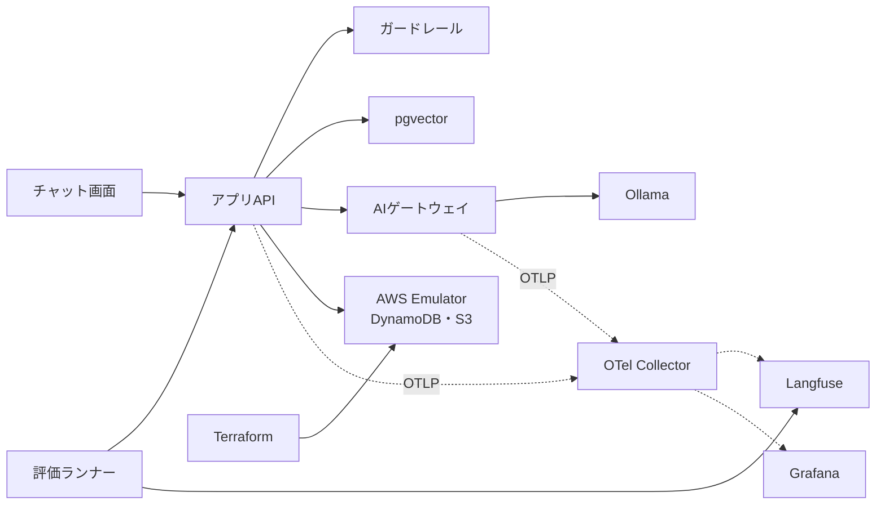

# コンポーネント解説

このプラットフォームを構成する部品ごとの解説。それぞれ「何をするものか」「このリポジトリでどう使っているか」「仕組み」「学ぶポイント」「つまずきやすい点」をまとめている。なぜその部品を選んだかは、各ページから[ADR](../adr/index.md)へリンクしている。

## 全体の中での位置

## 一覧

| 区分 | コンポーネント | ひとことで |
| --- | --- | --- |
| アプリ | [アプリAPIとチャット画面](app.md) | 質問を受けて、検索・生成・保存をまとめるRAGチャット本体 |
| アプリ | [ガードレール（Presidio）](guardrail.md) | 入力と出力のPIIをマスクし、インジェクションを止める |
| データ | [pgvector](pgvector.md) | 埋め込みを保存して近いものを探す、Postgresの拡張 |
| モデル | [AIゲートウェイ（Envoy AI Gateway）](ai-gateway.md) | LLM呼び出しの中継役。振り分け・上限・記録を1か所で行う |
| モデル | [Ollama](ollama.md) | 手元のマシンでLLMを動かすランタイム |
| AWS | [AWS Emulator](aws-emulator.md) | AWSのAPIを手元で再現する。DynamoDBとS3に使う |
| 観測 | [OTel Collector](otel-collector.md) | テレメトリーを受けて、行き先ごとに振り分ける |
| 観測 | [Langfuse](langfuse.md) | LLMのトレース・評価・データセットを管理する |
| 観測 | [Grafana（otel-lgtm）](grafana.md) | メトリクス・ログ・トレースで死活監視をする |
| 改善 | [評価ランナー](evaluation.md) | 評価データセットを流して採点し、前回と比べる |
| 基盤 | [Terraform](terraform.md) | インフラをコードで書き、エミュレーターと実AWSに流す |
| 基盤 | [品質チェックとサプライチェーン](quality.md) | リンター、シークレット検出、依存パッケージの対策 |
| 基盤（予定） | [サンドボックス（Kubernetes＋gVisor）](sandbox.md) | AIが生成したアプリを隔離して動かす |
