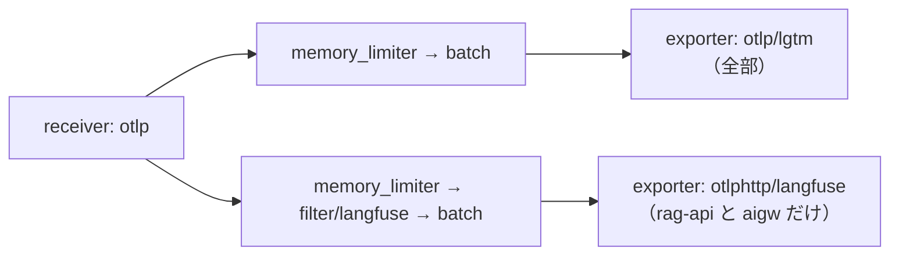

# OTel Collector

## ひとことで

アプリやゲートウェイから届くテレメトリー（トレース、メトリクス、ログ）を受け取り、加工して、行き先ごとに振り分ける中継役。

## このリポジトリでの役割

| 項目 | 内容 |
| --- | --- |
| イメージ | `otel/opentelemetry-collector-contrib` |
| 受信 | OTLP（gRPC :4317、HTTP :4318） |
| 送り先 | Grafana系（otel-lgtm）と Langfuse |
| 設定 | `infra/otel/collector.yaml` |
| 関連ADR | [ADR-004](../adr/0004-observability.md) |

## 仕組み

### パイプライン

Collector の設定は、3種類の部品をつないだパイプラインで書く。

| 部品 | 役割 | このリポジトリでの例 |
| --- | --- | --- |
| receiver | 受け取る | `otlp`（gRPC と HTTP） |
| processor | 加工する | `memory_limiter`、`batch`、`filter/langfuse` |
| exporter | 送り出す | `otlp/lgtm`、`otlphttp/langfuse` |



トレースのパイプラインを2本にしている。Grafana には全部を送り、Langfuse にはLLMに関係するサービス（`rag-api` と `aigw`）のspanだけを送る。

### filter processor

OTTL（OpenTelemetry Transformation Language）という式で、条件に合うデータを落とす。

```yaml
filter/langfuse:
  traces:
    span:
      - 'resource.attributes["service.name"] != "rag-api" and resource.attributes["service.name"] != "aigw"'
```

### Langfuse への認証

Langfuse の OTLP の受け口は、Basic 認証で守られている。公開鍵と秘密鍵を `公開鍵:秘密鍵` の形でつなぎ、Base64 にしたものを `Authorization` ヘッダーに載せる。`task env` がこの値（`LANGFUSE_AUTH`）を作る。

## 学ぶポイント

- アプリから観測基盤へ直接送らず、Collector を挟む理由（送り先を変えてもアプリを変えずに済む、加工や間引きができる）
- OTTL によるフィルターと加工
- GenAIの属性名が変わったときに、Collector で名前を付け替えて吸収する考え方

## つまずきやすい点

- core 版のイメージには filter processor が入っていない。contrib 版を使う
- `memory_limiter` は processor の先頭に置く
- Langfuse に送るspanを絞りすぎると、トレースの親子がつながらなくなる

## 参考資料

- [OpenTelemetry Collector](https://opentelemetry.io/docs/collector/)
- [Filter processor](https://github.com/open-telemetry/opentelemetry-collector-contrib/tree/main/processor/filterprocessor)
- [Langfuse: OpenTelemetry](https://langfuse.com/integrations/native/opentelemetry)
