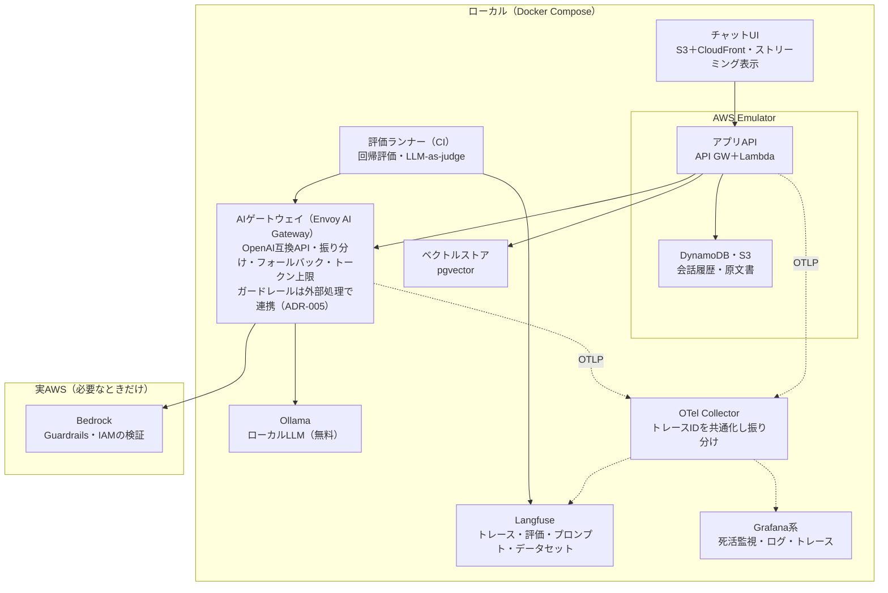
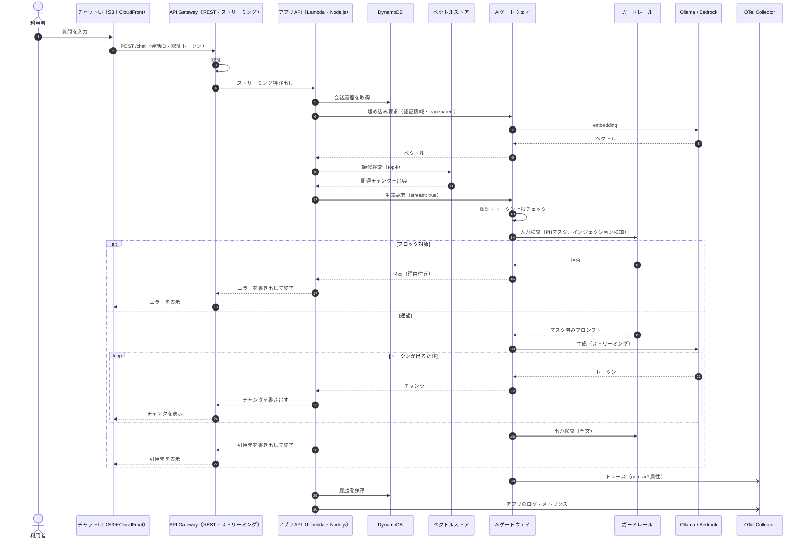
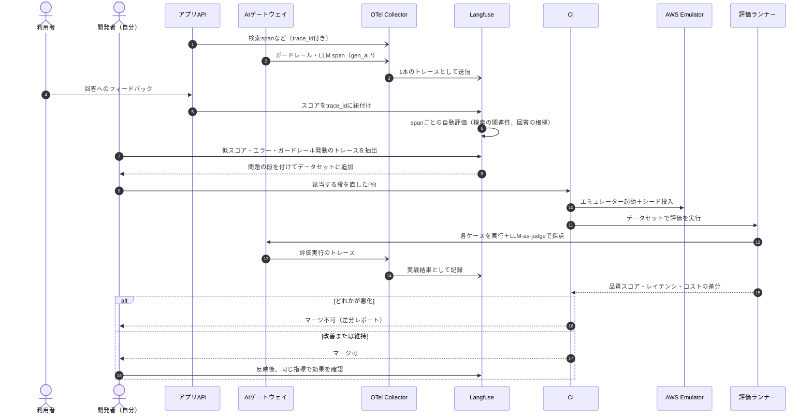
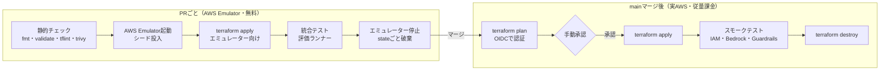

# 個人学習用 AI開発プラットフォーム デザインドック

国内外の社内AI基盤（Uber GenAI Gateway、デジタル庁「源内」、東京海上日動システムズの全社生成AI実行基盤など）に共通する「アプリ → AIゲートウェイ → 複数モデル」の構成を、個人のローカル環境で再現して学ぶ。基盤はAWS Emulator（2026年11月11日GA）とOSSで組み、実AWSは差分の検証だけに使う。

!!! info "現在地"
    ADRは12件で、ADR-001・002・004・006・011は決定済み。MVP（M1＋M2）を実装中。ADR-003・009はMVPのために仮決め（pgvector＋公開技術ドキュメント）。

## 背景と目的

**ゴール**

- AIゲートウェイ（認証、利用量の上限、PIIマスク、ルーティング、フォールバック）を自分で設定・運用できる
- RAGチャットを1本、トレースから評価・改善まで一周回せる
- ログ基盤、セキュリティ、改善のアウターループを含めた全体像を説明できる
- 実務（金融系クライアント案件）やAWS SA Proの学習に転用できる知見を残す

**非ゴール**

- 本番運用レベルの可用性・スケーラビリティ
- 独自モデルの学習・ファインチューニング
- マルチテナント、SSOなどの組織向け機能

## 全体アーキテクチャ

アプリ層とデータ層はAWS Emulator上で動かし、LLM呼び出しはすべてAIゲートウェイ（Envoy AI Gateway）を経由してOllamaか実Bedrockに送る。観測・評価の系統は別にまとめる。

実線はリクエスト、破線はテレメトリ（OTLP）。実AWSは、ローカルでは確かめられないBedrockの推論、Bedrock Guardrails、IAMの検証にだけ使う。

## コンポーネント詳細

すべてDocker Composeでローカルに立て、実AWSを使うのはBedrockとIAMの検証だけ。

| レイヤー | コンポーネント | 役割 | 実行場所 | 関連ADR |
| --- | --- | --- | --- | --- |
| アプリ | チャットUI（自作SPA） | 利用者の入口。回答をストリーミングで少しずつ表示 | 実AWS: S3＋CloudFront（OAC）。ローカル: 開発サーバー | [009](adr/0009-dataset.md), [011](adr/0011-chat-streaming.md) |
| アプリ | API Gateway（REST、ストリーミング） | 認証とPOST /chatの入口。応答を少しずつ返す | AWS Emulator（ストリーミングの再現は未確認） | [011](adr/0011-chat-streaming.md) |
| アプリ | アプリAPI（Lambda、Node.js） | RAGのオーケストレーション、ゲートウェイの出力の中継、履歴保存 | AWS Emulator | [006](adr/0006-iac-cicd.md), [011](adr/0011-chat-streaming.md) |
| データ | DynamoDB | 会話履歴、ユーザーフィードバック | AWS Emulator | — |
| データ | S3 | RAGの原文書、インデックス用ファイル | AWS Emulator | — |
| データ | ベクトルストア | 埋め込み検索 | pgvector（仮決め） | [003](adr/0003-vector-store.md) |
| ゲートウェイ | AIゲートウェイ | OpenAI互換API、モデルの振り分け、フォールバック、トークン単位のレート制限、GenAIメトリクスとトレース | ローカル（Envoy AI Gateway、aigw run）。後でK8sに載せる | [002](adr/0002-ai-gateway.md) |
| ゲートウェイ | ガードレール | PIIマスク、プロンプトインジェクション検知 | ローカル（候補: Presidio、LLM Guard。ゲートウェイの外部処理として連携） | [005](adr/0005-guardrails.md) |
| モデル | ローカルLLM | 普段の開発・評価を無料で回す | ローカル（Ollama） | [001](adr/0001-local-llm.md) |
| モデル | Bedrock | 品質比較、Bedrock Guardrailsの検証 | 実AWS（必要時のみ） | [001](adr/0001-local-llm.md), [007](adr/0007-aws-budget.md) |
| 観測 | OTel Collector | トレース・メトリクス・ログの集約と振り分け | ローカル | [004](adr/0004-observability.md) |
| 観測 | Langfuse | LLMトレース、評価スコア、プロンプト管理、データセット | ローカル（Postgres、ClickHouse、Redis、S3互換ストレージ） | [004](adr/0004-observability.md) |
| 観測 | Grafana系 | 死活監視。全体のメトリクス、ログ、トレース（Tempo）、アラート | ローカル | [004](adr/0004-observability.md) |
| 改善 | 評価ランナー | CIでの回帰評価、LLM-as-judge | ローカル / CI | [008](adr/0008-evaluation.md) |
| 基盤 | IaC（Terraform） | エミュレーターと実AWSに同じコードで構築 | CI/CD | [006](adr/0006-iac-cicd.md) |
| 基盤 | CI/CD | 静的チェック、エミュレーターへのapplyとテスト、実AWSへの承認付きapply | GitHub Actions | [006](adr/0006-iac-cicd.md) |

APIやWebページを隔離して動かす実行基盤は、Kubernetes＋gVisorで追加する方向（[ADR-010](adr/0010-sandbox.md)、未決定）。

## シーケンス図

すべてのLLM呼び出し（埋め込み、生成、評価の判定）がゲートウェイを通り、そこから出たトレースが改善ループの入力になる。

### 1. RAGチャットのリクエスト

### 2. 改善のアウターループ

## 横断関心事

観測・セキュリティ・改善は、すべてゲートウェイを起点にする。全LLM呼び出しがそこを通るので、施策を1箇所に集められる。

### 観測・ログ

- 全コンポーネントがOTLPでOTel Collectorに送り、W3C Trace Context（traceparent）を引き継いで、画面からLLMまでを1本のトレースにする（[ADR-004](adr/0004-observability.md)）
- Collectorで振り分ける：全トレース・メトリクス・ログ → Grafana系（死活監視）、LLM関連のspan → Langfuse（AI処理の詳細と評価）
- トレースIDが共通なので、Grafanaのアラートから同じIDでLangfuseを開いて原因を追える
- ゲートウェイ（Envoy AI Gateway）はトークン数・レイテンシなどのGenAIメトリクスとトレースを出す。コストはトークン数から集計する
- 制約：OTelのGenAIセマンティック規約は2026年6月に専用リポジトリへ移り、Development扱い。属性名は変わる前提で、Collectorで吸収する

### セキュリティ

- 入力側：PIIマスク、プロンプトインジェクション検知をゲートウェイで必ず通す
- 出力側：機密情報の漏洩チェック、引用元のない回答の検出
- 鍵管理：プロバイダの本物の鍵はゲートウェイだけが持ち、アプリには自分用の認証情報だけを渡す
- ログの扱い：プロンプト本文を記録するか、マスク後だけ記録するかを決める（[ADR-005](adr/0005-guardrails.md)）
- IAM：AWS EmulatorはIAMポリシーを実AWSと同じようには評価しない。権限の検証は実AWSで行う（[ADR-007](adr/0007-aws-budget.md)）

### 改善のアウターループ

OTelで追ったトレースをそのまま改善ループの入力にする。アプリAPI・検索・ゲートウェイ・LLMを1本のトレースでつなぐので、品質の問題がどの段で起きたかを特定してからデータセットに入れられる。

| OTelで取る信号 | 取る場所（span） | 改善ループでの使い方 |
| --- | --- | --- |
| 検索結果の件数・スコア | アプリAPIの検索span | 関連文書が取れていない質問を抽出し、検索側（チャンク分割・埋め込み）の改善対象にする |
| ガードレールのブロック・マスク | ゲートウェイのガードレールspan | 誤検知・見逃しの例をデータセットにする |
| フォールバック・エラー・タイムアウト | ゲートウェイのLLM span | モデルとルーティング設定を見直す |
| レイテンシ・トークン数・コスト | LLM spanのgen_ai.*属性 | CIの合格条件に、品質スコアと並べて入れる |
| ユーザーフィードバック | アプリAPI（trace_idに紐付け） | 低評価のトレースを優先してデータセットに入れる |

1. 入ってきたトレースにspanごとの自動評価（LLM-as-judge）をかける。検索spanには関連性、生成spanには根拠の有無、と段ごとに別の評価を付ける
2. 低スコア・エラー・低評価・ガードレール発動のトレースを抽出し、問題の段（検索 / 生成 / ガードレール）を付けてデータセットに入れる
3. 段に合わせて直す：検索（チャンク・埋め込み）、プロンプト、ルーティング、ガードレール設定
4. CIで回帰評価を回す。品質スコアに加え、評価実行時のトレースから取ったレイテンシ・コストも比べ、どれかが悪化したらマージしない
5. 反映した後、同じ指標で効果が出たかを確かめる

## 検証戦略（ローカルと実AWSの分担）

開発とCIはローカルで無料で回し、実AWSは「エミュレーターでは確かめられないもの」だけに使う。

| 確かめたいこと | ローカル / PRのCI（AWS Emulator） | 実AWS（mainマージ後のCI/CD） |
| --- | --- | --- |
| アプリロジック、S3 / DynamoDB / Lambdaの動作 | できる（サービスごとのFidelityスコアを確認） | スモークテストだけ |
| IaC（Terraform） | PRごとにapplyして確認（リソースごとに再現度が違う） | plan → 承認 → apply → destroy |
| LLMの推論 | Ollama経由（Bedrockの再現は未確認、ADR-001） | Bedrock |
| IAM・リソースポリシー | 静的解析のみ（エミュレーターは拒否されるべきリクエストも通す） | できる |
| スロットリング・障害・リージョン差 | できない | できる |
| データの永続化 | できない（停止で消えるため、シードスクリプトで毎回投入） | できる |

### CI/CDパイプライン（ADR-006）

PRではエミュレーターに対して無料で検証し、実AWSへはmainマージ後に手動承認を挟んでだけ出す。同じTerraformコードを、接続先の設定だけ変えて両方に流す。

エミュレーター段のapply成功は「API呼び出しが通る」ことの確認で、IAMの正しさは保証しない。IAMは静的解析と実AWS段で確かめる。

### 実装ライン（ソフトウェアファクトリー化、ADR-012）

このCI/CDの前に、「仕様（人）→ コーディングエージェント（nonoで隔離、AWS Emulatorで検証）→ PR」の工程をつなげ、人は仕様・受け入れ条件・マージと実AWSへの承認だけを持つ。品質検査は上のCIをそのまま使い、改善ループで見つかった問題は仕様としてラインの入口に戻す。M5の後に試す。

**コスト方針**

- ローカルは0円（Langfuseを含めるとメモリを食うので、マシンスペックに注意）
- 実AWSは検証のたびに立てて壊す。常時課金のサービス（Kendraなど）は使わない
- 月の上限額とAWS Budgetsのアラートは未定（[ADR-007](adr/0007-aws-budget.md)）

## マイルストーン

日付は未定。各フェーズは完了条件を満たしたら次へ進む。

1. **M1 ローカル基盤**：AWS Emulator、ゲートウェイ、Ollama、LangfuseをDocker Composeで立ち上げ、アプリ層はTerraformでエミュレーターにapplyする。PRのCIもここで作る
    - 完了条件：1リクエストがLangfuseに1トレースとして見える
2. **M2 RAGチャット**：題材ドキュメントの取り込みと引用付き回答
    - 完了条件：質問から回答までがシーケンス図どおりに動く
3. **M3 ガードレール**：PIIマスクとインジェクション検知を組み込む
    - 完了条件：用意した攻撃プロンプトとPII入り入力が、トレース上でブロック・マスクされている
4. **M4 改善ループ**：評価データセット、LLM-as-judge、CIでの回帰評価
    - 完了条件：プロンプトを変えるとCIにスコア差分が出る
5. **M5 実AWS検証**：mainマージ後のCI/CD（plan → 承認 → apply → destroy）で、Bedrock、Bedrock Guardrails、IAMを実AWSで確かめる
    - 完了条件：ローカルとの差分を記録し、リソースを破棄する

## 未解決事項とADR一覧

ADRは12件で、ADR-001・002・004・006・011は決定済み。M1の前提になるADRは決まったので、M1に着手できる。残りは作りながら詰める。一覧は [ADR](adr/index.md) を参照。

## 参考資料

- [AWS Emulatorを使用してローカルでAWSに対してアプリケーションをテストする（AWSブログ）](https://aws.amazon.com/jp/blogs/news/test-your-applications-against-aws-locally-with-aws-emulator/)
- [Fidelity in AWS Emulator](https://docs.aws.amazon.com/emulator/latest/userguide/fidelity.html)
- [Uber: GenAI Gateway](https://www.uber.com/blog/genai-gateway/)
- [Envoy AI Gateway Reference Architecture](https://aigateway.envoyproxy.io/blog/envoy-ai-gateway-reference-architecture/)
- [ガバメントAI「源内」OSS公開（CodeZine）](https://codezine.jp/news/detail/24125)
- [GenU 公式サイト](https://aws-samples.github.io/generative-ai-use-cases/en)
- [Langfuse Self-hosting](https://langfuse.com/self-hosting)
- [Langfuse: LLM-as-a-Judge](https://langfuse.com/docs/evaluation/evaluation-methods/llm-as-a-judge)
- [OpenTelemetry for LLMs（Middleware）](https://middleware.io/blog/opentelemetry-for-llms/)
